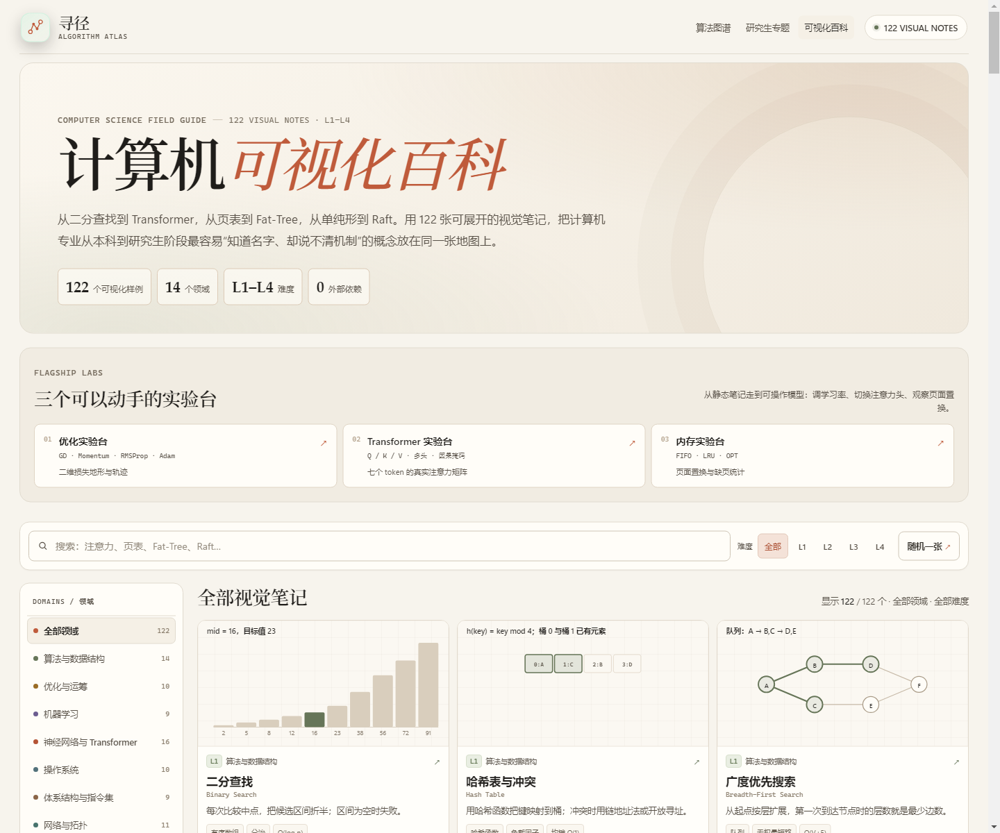

# 寻径 · 算法图谱 Algorithm Atlas

从本科基础到博一难度的交互式计算机学习站：**27 个算法实验室、122 个可视化样例、6 个研究生专题**，以及优化 / Transformer / 内存三个新的交互实验台。项目采用 **Vite + TypeScript + 原生 SVG**，无图表库、无运行时后端依赖。



[](https://github.com/zfqxuz/algorithm-atlas/actions/workflows/ci.yml)

**在线访问：<http://154.222.16.237:9000/>**

**GitHub Pages：<https://zfqxuz.github.io/algorithm-atlas/>**

**GitHub 仓库：<https://github.com/zfqxuz/algorithm-atlas>**

静态站点运行在非 root、只读根文件系统的 Nginx 容器中，仅通过 `personal-net` 暴露 9000 端口。部署与运维见 [`deploy/README.md`](deploy/README.md)。

> 若本机系统代理会拦截非标准端口，请把 `154.222.16.237` 加入代理绕过列表，或暂时关闭代理。

更多预览：[优化实验台](screenshots/optimization-lab.png) · [Transformer 实验台](screenshots/transformer-lab.png) · [内存实验台](screenshots/memory-lab.png) · [可视化百科](screenshots/visuals.png) · [移动端目录](screenshots/visuals-mobile.png) · [手机端展开](screenshots/gallery-modal-mobile.png) · [排序实验室](screenshots/sorting-lab.png) · [红黑树](screenshots/structures-rb.png) · [调度实验室](screenshots/scheduling-lab.png) · [LCS 动态规划](screenshots/advanced-lcs.png) · [图算法实验台](screenshots/graph-lab.png) · [生成图参数面板](screenshots/graph-modal-mobile.png) · [研究生专题](screenshots/research-top.png) · [最大流交互](screenshots/research-flow.png)

## 一张图谱，五个经典实验室 + 三个新实验台 + 一个专题层

| 类型 | 页面 | 内容 | 难度 |
| --- | --- | --- | --- |
| 排序与选择 | [`sorting-lab.html`](sorting-lab.html) | 冒泡、选择、插入、希尔、归并、快速、堆排序、计数排序 | L1–L3 |
| 图与网络 | [`graph-lab.html`](graph-lab.html) | BFS、DFS、Dijkstra、Prim；PageRank 在进阶实验室 | L1–L4 |
| 数据结构 | [`structures-lab.html`](structures-lab.html) | BST、二叉堆、并查集、AVL、红黑树 | L1–L3 |
| 调度与资源分配 | [`scheduling-lab.html`](scheduling-lab.html) | FCFS、SJF、优先级、时间片轮转、EDF、多机 LPT | L1–L4 |
| 算法范式与进阶 | [`advanced-lab.html`](advanced-lab.html) | LCS、KMP、Andrew 凸包、PageRank | L2–L4 |
| 优化实验台 | [`optimization-lab.html`](optimization-lab.html) | GD、Momentum、RMSProp、Adam；二维损失地形与轨迹 | L2–L3 |
| Transformer 实验台 | [`transformer-lab.html`](transformer-lab.html) | 真实 Q/K/V、多头注意力、因果掩码、行统计 | L3–L4 |
| 内存实验台 | [`memory-lab.html`](memory-lab.html) | FIFO / LRU / OPT 页面置换、命中率与帧状态 | L2 |
| 可视化百科 | [`visuals.html`](visuals.html) | 122 个跨 14 个领域的视觉笔记，领域/难度/关键词检索 | L1–L4 |
| 研究生专题 | [`research.html`](research.html) | 最大流/最小割、LP、NP 完全性、近似、随机、在线；含最大流交互 | L4 |

## 122 个可视化样例

[`visuals.html`](visuals.html) 用 14 个领域覆盖计算机专业从本科到研究生的概念地图：

- **算法与数据结构**：二分、哈希、BFS/DFS、拓扑、并查集、Trie、线段树、树状数组、单调栈、滑动窗口、LRU、布隆过滤器、跳表
- **优化与运筹**：梯度下降、SGD、动量、Adam、牛顿法、模拟退火、遗传算法、粒子群、线性规划、分支定界
- **机器学习**：线性/逻辑回归、kNN、决策树、随机森林、GBDT、SVM、K-Means、PCA
- **神经网络与 Transformer**：感知机、MLP、反向传播、CNN、ResNet、RNN、LSTM、自编码器、GAN、扩散、注意力、多头、位置编码、Transformer 块、BERT、GPT
- **操作系统**：进程状态、上下文切换、系统调用、分页、TLB、页面置换、inode、磁盘调度、死锁、信号量
- **体系结构与指令集**：CISC/RISC、流水线、冒险、分支预测、缓存层次、组相联、MESI、SIMD、调用约定
- **网络与拓扑**：OSI、星型/环型/Fat-Tree、链路状态、距离向量、TCP 握手/拥塞、滑动窗口、CSMA/CD、NAT/子网
- **数据库、编译、分布式、安全、图形学、计算理论、软件工程**：B+ 树、连接、2PL、MVCC、LSM、DFA、AST、SSA、GC、CAP、Raft、Paxos、一致性哈希、MapReduce、AES、RSA、DH、Merkle、TLS/PKI、ZKP、Bresenham、光栅化、Bezier、光线追踪、图灵机、停机问题、Git DAG、CI/CD 等

每个样例都有独立的小图、机制说明、观察点、标签与延伸链接；卡片可展开为大图和完整解释，支持深链 `#entry-id`、上一张/下一张与复制链接。

难度层级：

- **L1 本科基础**：入门数据结构、比较排序、遍历、FCFS/SJF。
- **L2 本科进阶**：分治、堆、平衡树、最短路、RR、LCS。
- **L3 高阶 / 研究生入门**：红黑树、计数排序、EDF、KMP、计算几何。
- **L4 研究生 / 博一**：PageRank、多机 LPT 近似，以及最大流、LP、NP-完全性、近似/随机/在线算法等研究生专题。

首页 [`index.html`](index.html) 会按「类型 × 难度」分组展示全部算法，支持按类型、难度筛选和关键词搜索。6 个研究生专题既有首页概念卡，也有 [`research.html`](research.html) 的完整长文：模型、定理、证明直觉、自测题、阅读材料、常见误区与关键界速查表。

## 数据生成参数

每个实验室都有独立的测试数据面板；参数改变后可以重新生成并重放：

| 实验室 | 可调参数 |
| --- | --- |
| 排序 | 数组规模 8–64、随机/近乎有序/逆序/少重复/锯齿分布、值域上限、随机种子 |
| 图 | 节点数 6–10、稀疏/适中/密集边密度、权重上限 9/20、随机种子；也可在 3 张手工图上切换 |
| 数据结构 | 初始节点数、键值上下限、随机种子；堆支持值域；并查集支持元素数与初始合并次数 |
| 调度 | 作业数、到达窗口、执行时间范围、截止期松弛范围、优先级档位、时间片、机器数、随机种子 |
| 进阶 | 序列长度/字母表、文本与模式长度/植入匹配、点集数量/范围/形状、图节点数/边概率/阻尼/迭代阈值 |
| 优化 | 损失函数（椭圆碗/Rosenbrock/各向异性）、优化器、学习率、起点（点击地形重设） |
| Transformer | 注意力头 1–3、因果掩码开关、查询 token 左右切换 |
| 内存 | FIFO/LRU/OPT、帧数 2–6、引用串长度、随机种子 |

生成器均使用带种子的 PRNG（或引擎内的确定性构造），因此同一组参数可以得到可复现的实验数据。

## 交互能力

- **播放 / 暂停 / 单步 / 重置**；排序、数据结构与进阶实验室支持速度倍率。
- **逐帧状态可视化**：柱状数组、SVG 树、堆与森林、甘特图、DP 表、字符串对齐、散点凸包、有向图排名。
- **算法骨架与当前行高亮**：每个实验室都有伪代码、核心不变量与复杂度说明；长代码块内部滚动并自动跟随当前行。
- **参数化实验**：支持观察同一算法在不同数据分布、规模、密度、截止期压力、阻尼系数下的行为差异。
- **响应式与键盘操作**：`Space` 播放/暂停、`→` 单步；窄屏保留水平滚动容器而不是压缩图表。
- **最大流小实验**：在研究生专题中逐步增广，观察残量路径、瓶颈容量、累计流量与最终最小割。
- **优化轨迹**：在二维损失地形上播放/单步，比较 GD、Momentum、RMSProp、Adam 的下降路径。
- **注意力矩阵**：真实 Q/K/V 计算、多头切换、因果掩码与行和/熵/输出范数。
- **页面置换**：逐次引用观察帧状态、命中/缺页与淘汰决策，比较 FIFO/LRU/OPT。

## 目录

```text
index.html                 算法图谱首页（类型 × 难度）
styles.css                 基础结构、图算法页面样式与生成图弹层
atlas.css                  图谱首页、共享实验室布局与各实验室组件
claude.css                 暖纸张视觉系统（覆盖层，最后加载）
catalog.js                 算法目录、难度元数据与研究生专题
atlas.js                   首页筛选、搜索、目录与专题渲染
lab-core.js                伪代码、播放器、种子与滚动等共享工具
graph-lab.html             图算法实验台（Dijkstra / BFS / DFS / Prim）
sorting-lab.html + .js     排序实验室
structures-lab.html + .js  数据结构实验室（BST / 堆 / 并查集 / AVL / 红黑树）
scheduling-lab.html + .js  调度实验室
advanced-lab.html + .js    进阶实验室（LCS / KMP / 凸包 / PageRank）
research.html + research.js 研究生专题长文 + 可交互最大流
visuals.html               计算机可视化百科（122 个样例）
optimization-lab.html      优化实验台
transformer-lab.html       Transformer / 自注意力实验台
memory-lab.html            页面置换实验台
src/visuals/               TypeScript 数据、渲染器与百科交互
src/labs/                  优化、注意力、页面置换的 TS 交互逻辑
public/                    favicon 等静态资源
vite.config.ts             Vite 多页面构建 + 旧页面兼容 + CSS 级联顺序
vitest.config.ts           TypeScript 数据测试
tsconfig.json              严格 TypeScript 配置
dijkstra.js                Dijkstra 核心与轨迹
graph-algorithms.js        BFS / DFS / Prim 轨迹
graphs.js                 手工图 + 带种子随机图生成器
app.js                     图算法 SVG 渲染、拖拽、播放与生成图弹层
engines/                   sorting / scheduling / tree / advanced / flow 纯算法引擎
build-standalone.js        生成图算法单文件版（内联基础样式与视觉主题）
deploy/                    Nginx + Docker Compose
tests/                     Node 单元测试、Vitest 数据测试与 CDP 浏览器检查脚本
.github/                   GitHub Actions CI / Pages
```

## 算法引擎

图形与控制层只消费引擎产出的不可变轨迹快照；纯引擎也可以单独在 Node 或浏览器中复用。

| 引擎 | 能力 |
| --- | --- |
| [`engines/sorting-engine.js`](engines/sorting-engine.js) | 8 种排序、分布生成器、逐帧比较/交换/计数快照 |
| [`engines/scheduling-engine.js`](engines/scheduling-engine.js) | 6 种调度策略、作业生成、甘特段时间片与指标 |
| [`engines/tree-engine.js`](engines/tree-engine.js) | BST / AVL / 红黑树插入与查找轨迹、旋转/染色事件、不变量统计 |
| [`engines/advanced-engine.js`](engines/advanced-engine.js) | LCS、KMP、Andrew 凸包、PageRank 及各自数据生成器 |
| [`engines/flow-engine.js`](engines/flow-engine.js) | Edmonds–Karp 最大流、逐步增广快照、最小割与可达集 |

树实验聚焦插入与查找；排序/调度/图/进阶均为完整可播放流程。数据结构的删除操作尚未纳入可视化，但引擎与渲染框架可以继续扩展。

## 本地运行

首次：

```powershell
pnpm install
pnpm dev
# 打开 Vite 输出的 http://127.0.0.1:5173/
```

旧版经典页面仍可以直接双击打开，但新增的可视化百科、优化、Transformer 与内存实验台使用 TypeScript 模块，需要通过 Vite 或静态服务器访问。

图算法单文件版：[`dijkstra-visualizer.html`](dijkstra-visualizer.html)。该文件把图算法所需 CSS/JavaScript 全部内联，适合离线分享。

## 开发、测试与构建

```powershell
pnpm run typecheck  # 严格 TypeScript 检查
pnpm test           # 101 个 Node 用例 + 4 个 Vitest 数据用例
pnpm run build      # 单文件图算法 + Vite 多页面生产构建到 dist/
pnpm run preview    # 预览 dist/
```

当前测试覆盖：Dijkstra/BFS/DFS/Prim、随机图生成器、8 种排序轨迹、6 种调度器、BST/AVL/红黑树不变量、LCS/KMP/凸包/PageRank、Edmonds–Karp 与最小割、专题锚点、122 条可视化数据的唯一性/完整性/链接有效性，共 **105 个用例**。

浏览器检查脚本 `tests/browser-check.mjs` 使用 Chrome DevTools Protocol，支持真实播放/单步、移动端尺寸、截图和 DOM 状态检查；它不属于 `pnpm test`，需要先启动带远程调试端口的 Chrome。

## 技术架构

- **静态优先**：所有可视化在浏览器内运行，生产产物是纯静态 `dist/`，可部署到 Nginx、GitHub Pages 或任意 CDN。
- **Vite + TypeScript**：新页面使用 TS 模块；旧页面保留经典脚本，由 Vite 多页面构建与兼容复制层逐步迁移。
- **pnpm + CI**：`pnpm-lock.yaml` 锁定依赖，GitHub Actions 执行 typecheck、105 个测试与生产构建；Pages 自动部署同一份 `dist/`。
- **122 条类型化数据**：所有可视化笔记由 `src/visuals/data` 中的类型化条目生成，渲染器在 `src/visuals/render.ts`，新增内容不需要复制页面模板。
- **无运行时依赖**：图形全部是原生 SVG/DOM；没有图表库、CSS 框架或后端服务。
- **CSS 级联保护**：生产构建会把 `atlas → claude → visuals` 排到正确顺序，避免旧主题覆盖视觉层。

当前没有后端。账户、学习进度同步、AI 讲解或内容管理真正出现需求时，再加一个薄 API 服务即可；不建议为了“前后端分离”提前引入数据库与鉴权。

## 设计说明

视觉采用 Claude 官网式暖纸张阅读界面：象牙色底、白色卡片、近黑文字、陶土色强调，展示标题用衬线体，正文以 16px 左右为主，辅助标签不低于 11–12px。原先 7–10px 的浅灰标签被整体替换，代码块、图示标签、表格与移动端控件也同步放大并提高对比度。

颜色语义保持稳定：鼠尾草绿表示已就位/已完成，赭石表示当前动作，梅紫与陶土色标记高级状态。所有图形由原生 SVG 或 DOM 绘制；`claude.css` 只覆盖视觉，不改变业务类名或 SVG 结构。

## 部署

服务器目录约定、镜像、只读根文件系统、健康检查、更新与回滚步骤见 [`deploy/README.md`](deploy/README.md)。生产部署使用 `pnpm run build` 生成的 `dist/`。当前线上地址为：

- Atlas：<http://154.222.16.237:9000/>
- GitHub Pages：<https://zfqxuz.github.io/algorithm-atlas/>
- 可视化百科：<http://154.222.16.237:9000/visuals.html>
- 优化实验台：<http://154.222.16.237:9000/optimization-lab.html>
- Transformer 实验台：<http://154.222.16.237:9000/transformer-lab.html>
- 内存实验台：<http://154.222.16.237:9000/memory-lab.html>
- 图算法实验台：<http://154.222.16.237:9000/graph-lab.html>
- 研究生专题：<http://154.222.16.237:9000/research.html>
- 单文件图算法：<http://154.222.16.237:9000/dijkstra-visualizer.html>
- 健康检查：<http://154.222.16.237:9000/healthz>

## License

MIT © 2026 zfqxuz. See [`LICENSE`](LICENSE).

Issues and pull requests are welcome; see [`CONTRIBUTING.md`](CONTRIBUTING.md) and [`ROADMAP.md`](ROADMAP.md).
