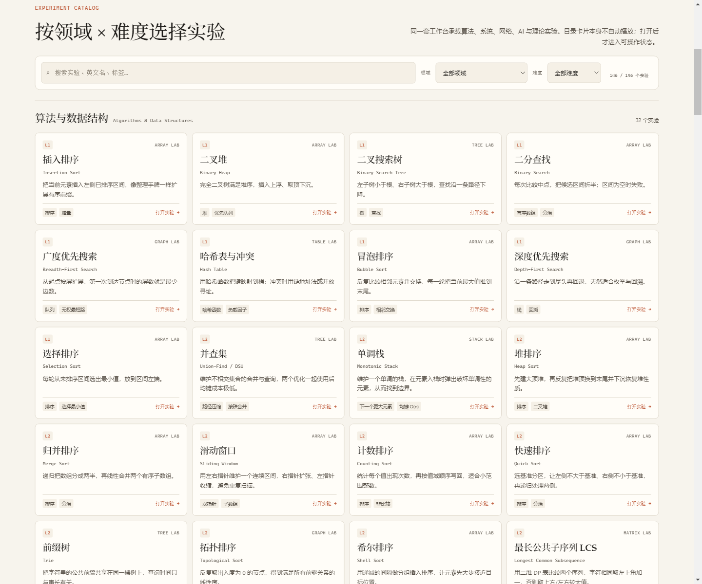
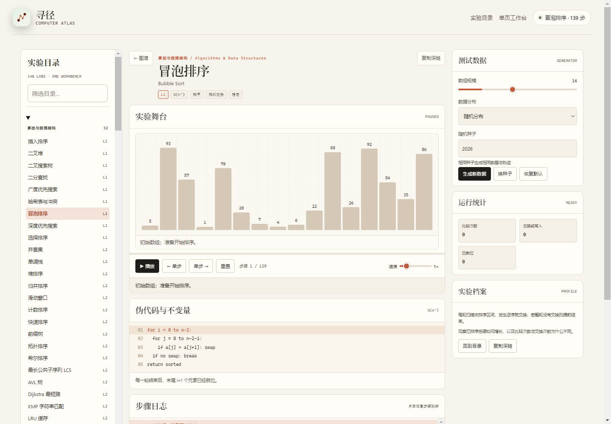
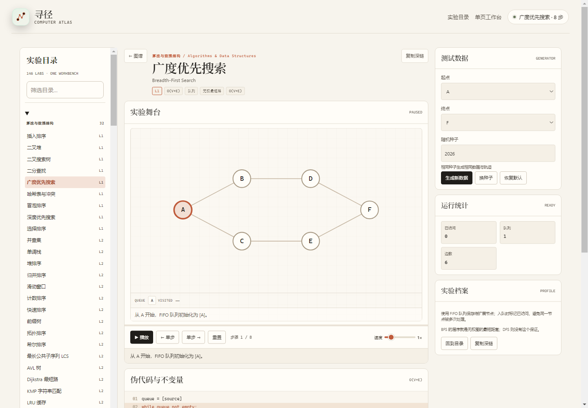
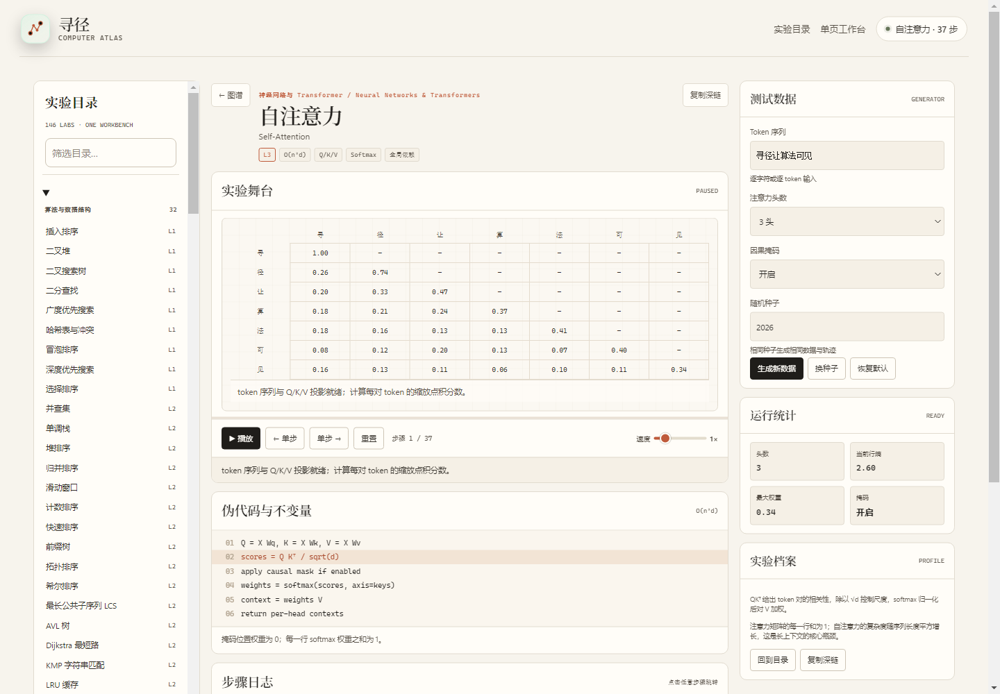
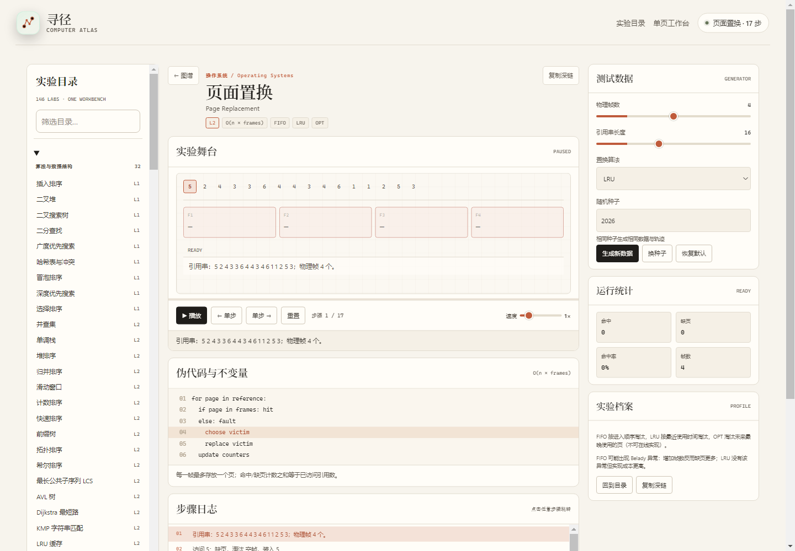
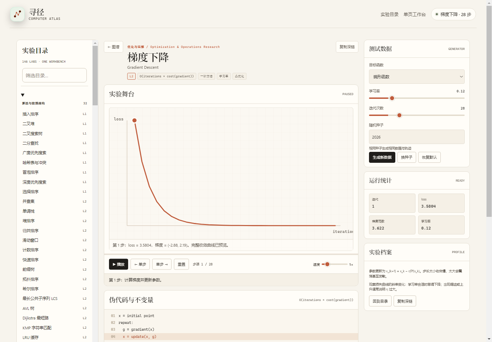
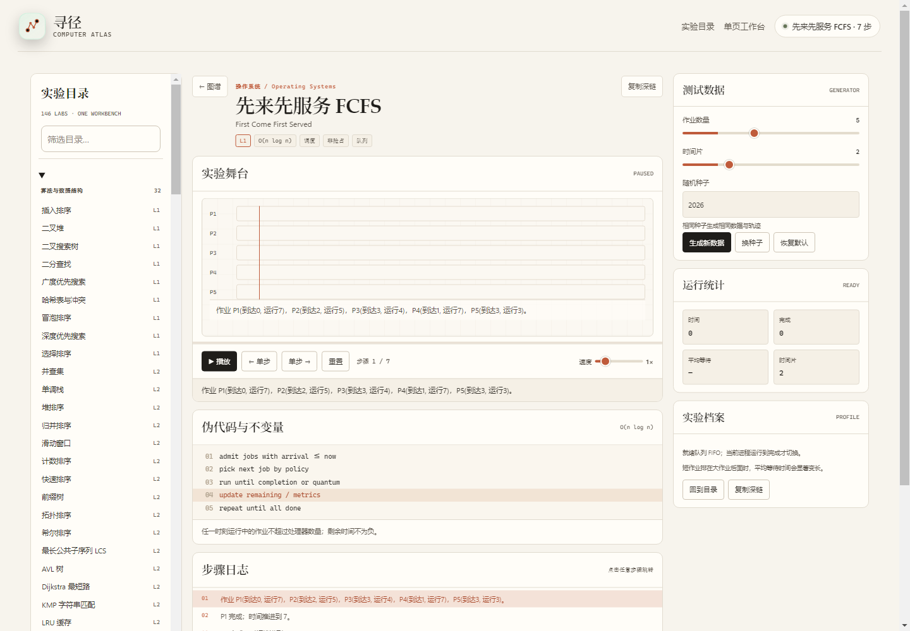
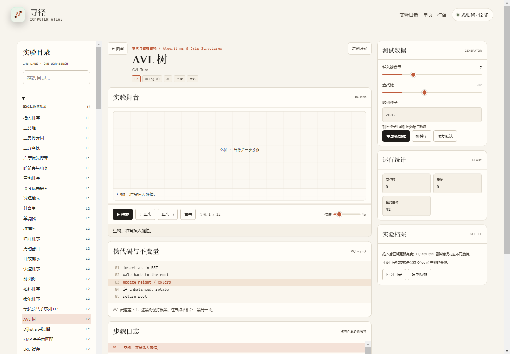
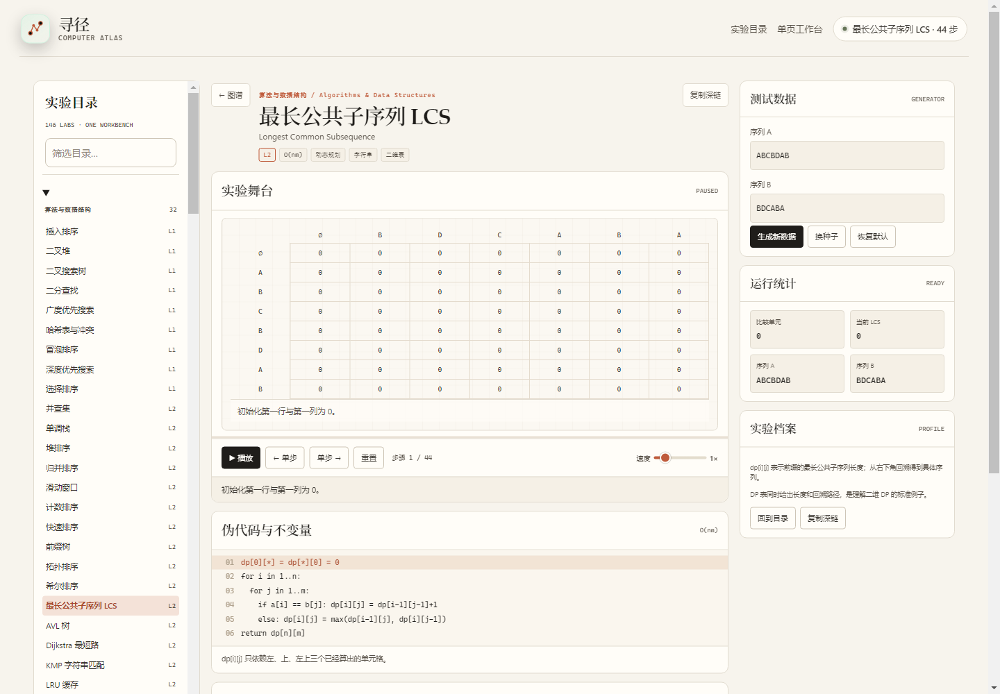

# 寻径 · 计算机图谱 / Algorithm Atlas

**一个页面，一个工作台，146 个可交互实验。**

不是 122 张会动的示意图，也不是“算法页 + 可视化百科页”两套入口。所有实验都在 [`index.html`](index.html) 里完成选择、生成数据、播放、单步、回退、重置和深链恢复；旧的 `*-lab.html` 只保留兼容重定向。

[](https://github.com/zfqxuz/algorithm-atlas/actions/workflows/ci.yml)
[](https://github.com/zfqxuz/algorithm-atlas/actions/workflows/pages.yml)


## 现在是什么

- **146 个唯一实验**：122 个跨领域条目 + 24 个原实验室条目；BFS、DFS、并查集等重复概念已合并。
- **14 个领域**：算法与数据结构、优化、机器学习、神经网络与 Transformer、操作系统、体系结构/指令集、网络拓扑、数据库、编译、分布式、安全、图形学、计算理论、软件工程。
- **一套工作台**：每个实验都有测试数据生成器、可复现种子、播放/暂停、前进一步/后退一步、重置、速度、进度、实时指标、伪代码当前行、不变量、步骤日志。
- **一个深链格式**：`/#lab/<id>`，例如 [`/#lab/attention`](index.html#lab/attention)、[`/#lab/page-replacement`](index.html#lab/page-replacement)。
- **没有后端**：纯静态 `dist/`，可部署到 Nginx、GitHub Pages 或任意 CDN。



## 排序实验室现在长什么样

打开 [`/#lab/bubble`](index.html#lab/bubble) 可以看到：

- 数组规模 6–28、分布、随机种子；
- 生成真实数组、比较次数、交换/写入、已就位；
- 播放、单步、回退、重置、速度、步骤日志；
- 伪代码当前行与不变式。

其余实验沿用同一套结构，只替换领域参数、舞台和指标。



## 几个代表性实验

### 图与网络

BFS/DFS/Dijkstra/Prim/PageRank 都有真实队列、visited、距离或分数轨迹；起点/终点可切换。



### Transformer 自注意力

可编辑 token、头数、因果掩码；舞台显示注意力矩阵，右侧给出当前行熵、最大权重和掩码状态。



### 页面置换

物理帧数、引用串长度、FIFO/LRU/OPT；每一步显示命中/缺页、被淘汰页和累计命中率。



### 梯度下降

函数、学习率、迭代次数、种子；显示完整 loss 收敛曲线和当前梯度。



### 调度与平衡树

FCFS/SJF/优先级/RR/EDF/LPT 使用真实作业与时间轴；BST/AVL/红黑树使用真实旋转/变色轨迹。





### LCS 与动态规划

两个可编辑序列生成 DP 表；单元格、依赖和最终长度同步更新。



## 单页结构

```text
index.html                     唯一入口
├── 图谱模式                    Hero + 146 实验目录
└── 工作台模式                  #lab/<id>，同页切换
    ├── 左：实验目录             14 领域，搜索/折叠
    ├── 中：实验舞台             播放 / 单步 / 回退 / 重置 / 速度
    │      + 伪代码 + 步骤日志
    └── 右：测试数据             参数 / 种子 / 生成 + 指标 + 档案
```

旧的 `sorting-lab.html`、`graph-lab.html`、`visuals.html`、`research.html` 等只执行兼容跳转，不再承载独立内容。下一步不需要在两个页面之间同步状态。

## 代码结构

```text
src/app/
├── catalog.ts       122 个领域条目 + 24 个原实验室条目、去重与领域分组
├── legacy.ts        原 27 个实验室的元数据
├── params.ts        每个舞台类型的参数 schema 与默认值
├── engines.ts       数组/图/树/矩阵/曲线/时间轴/页帧/表格/栈/向量/层/流水线/拓扑引擎
├── stage.ts         13 种原生 SVG/DOM 舞台渲染器
└── main.ts          单页路由、目录、工作台、播放器、深链
app.css              单页图谱 + 工作台样式
```

核心约束在 [`tests/labs.test.ts`](tests/labs.test.ts)：146 个条目每个都必须有参数、伪代码、至少 5 帧、非空指标、合法代码行、状态变化和完成标记。

## 本地运行

```bash
pnpm install --frozen-lockfile
pnpm dev
pnpm test
pnpm run typecheck
pnpm run build
pnpm preview
```

`pnpm test` 运行 **101 个 Node 引擎测试 + 5 个 Vitest 单页实验契约测试 = 106 个用例**。

## 在线地址

- 正式站：<http://154.222.16.237:9000/>
- 排序实验：<http://154.222.16.237:9000/#lab/bubble>
- Transformer：<http://154.222.16.237:9000/#lab/attention>
- 页面置换：<http://154.222.16.237:9000/#lab/page-replacement>
- GitHub Pages：<https://zfqxuz.github.io/algorithm-atlas/>
- GitHub 仓库：<https://github.com/zfqxuz/algorithm-atlas>

## 部署

服务器目录、只读容器、健康检查、更新与回滚见 [`deploy/README.md`](deploy/README.md)。

生产产物是 `dist/`。当前部署：

- Nginx 容器 `dijkstra-visualizer`，`personal-net`，宿主机 9000；
- 最新备份：`/opt/personal/dijkstra/site-backup-20261030-192858`；
- GitHub Actions 执行 typecheck、106 个测试、生产构建和 Pages 部署。

## 兼容性

- 旧 `sorting-lab.html#bubble` → `index.html#lab/bubble`
- 旧 `graph-lab.html#dijkstra` → `index.html#lab/dijkstra`
- 旧 `visuals.html#attention` → `index.html#lab/attention`
- 旧 `optimization-lab.html` → `index.html#lab/gradient-descent`
- 旧 `transformer-lab.html` → `index.html#lab/attention`
- 旧 `memory-lab.html` → `index.html#lab/page-replacement`

## 说明

- 13 种舞台类型覆盖不同领域；排序、图、树、页帧、调度、注意力、LCS 等使用真实状态机与轨迹。
- 一些概念型条目使用领域适配器把输入映射到可操作状态；所有条目都必须满足上述实验契约，不以静态图或纯高亮代替状态变化。
- 无账户、无后端、无外部字体或图表库。

## License

MIT © 2026 zfqxuz. See [`LICENSE`](LICENSE).

Issues and pull requests are welcome; see [`CONTRIBUTING.md`](CONTRIBUTING.md) and [`ROADMAP.md`](ROADMAP.md).
